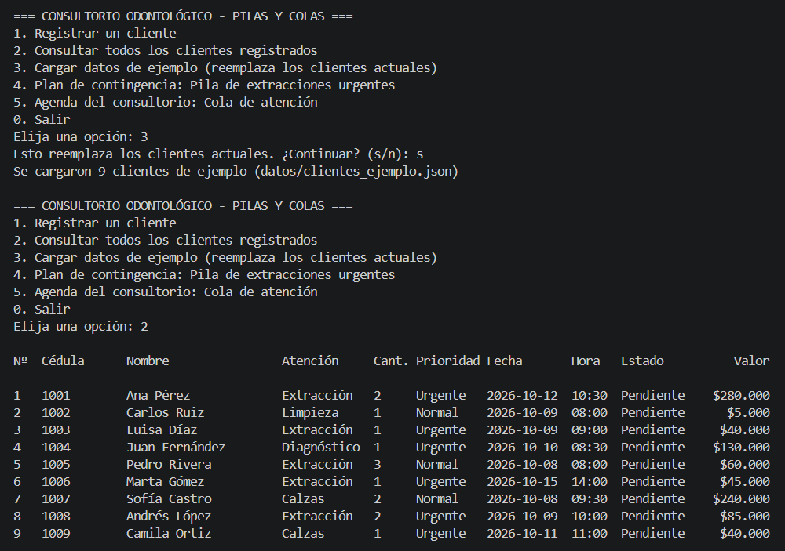
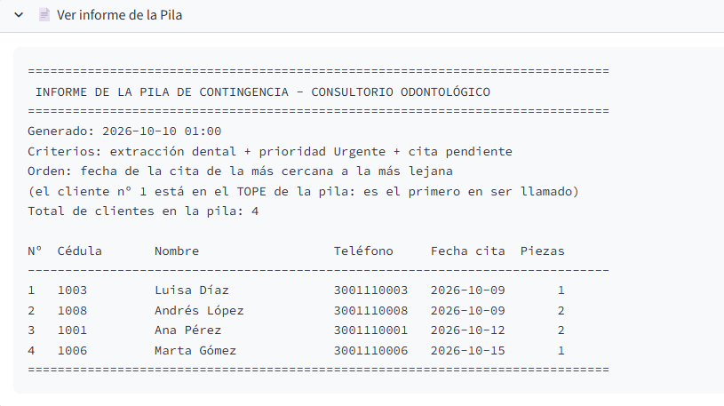
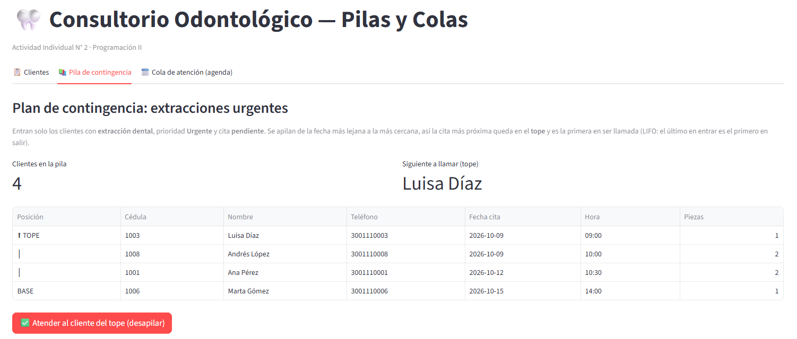
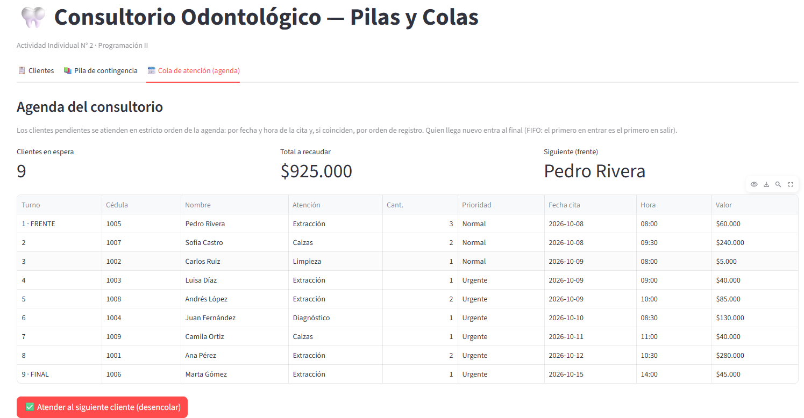

# 🦷 Consultorio Odontológico — Pilas y Colas

## 1. 📄 Introducción

Actividad Individual N° 2 de Programación II: **uso de estructuras dinámicas, pilas y colas**.
Es la continuación del programa del consultorio odontológico de la actividad 1.

Un consultorio necesita un **plan de contingencia** para los clientes que tienen
pendiente una extracción de piezas dentales y además son urgentes. Esos clientes se
organizan en una **Pila**. Además, el consultorio atiende a diario a los clientes
que llegan, en el estricto orden de su **agenda**, gestionada con una **Cola**.

## 2. ✅ Cómo se cumple el enunciado

| Requisito | Dónde se resuelve |
|---|---|
| Solo se llaman clientes que vienen para extracciones dentales | `es_candidato_a_la_pila()` en `consultorio.py` |
| Solo se atienden los que tienen prioridad "Urgente" | `es_candidato_a_la_pila()` en `consultorio.py` |
| La pila queda en orden de fecha, de la más cercana a la más lejana | `generar_pila_de_contingencia()` en `consultorio.py` |
| Informe de la Pila para llamar a los clientes | `generar_informe_de_la_pila()`: se muestra en pantalla y se guarda en `informe_pila.txt` |
| Generar la agenda y atender en estricto orden con una Cola | `generar_agenda()` y `atender_siguiente_cliente()` en `consultorio.py` |
| Implementación de la Pila | `estructuras/pila.py` (nodos enlazados) |
| Implementación de la Cola | `estructuras/cola.py` (nodos enlazados) |

## 3. 📁 Estructura del proyecto

```
Actividad_Individual_2_Pilas_y_Colas/
├── estructuras/
│   ├── __init__.py
│   ├── nodo.py              # Nodo: dato + referencia al siguiente
│   ├── pila.py              # Pila (LIFO): apilar, desapilar, ver_tope
│   └── cola.py              # Cola (FIFO): encolar, desencolar, ver_frente
├── datos/
│   └── clientes_ejemplo.json    # 9 clientes de ejemplo para probar
├── Capturas_app/                # capturas de pantalla de la ejecución
├── cliente.py               # clase Cliente y tabla de precios
├── entradas.py              # captura de datos por teclado con validación
├── consultorio.py           # clase Consultorio: administra la Pila y la Cola
├── programa_pila.py         # Programa 1: Pila de contingencia + informe
├── programa_cola.py         # Programa 2: Cola de atención (agenda)
├── main.py                  # Menú de consola que integra todo
├── app.py                   # Aplicación web (Streamlit)
├── requirements.txt         # Dependencias (solo Streamlit, para la app web)
├── definiciones.md          # Definiciones de pila, cola y nodo
├── README.md
├── LICENSE
└── .gitignore
```

## 4. 🧠 Cómo funcionan la Pila y la Cola

**Clases del proyecto.** `Cliente` guarda los datos de una cita y calcula el valor a pagar.
`Consultorio` reúne a los clientes y tiene la Pila y la Cola, con métodos como
`atender_cliente_del_tope()` y `atender_siguiente_cliente()`.

**Estructuras dinámicas.** La Pila y la Cola no usan una lista de Python: se construyen
encadenando objetos `Nodo`, donde cada nodo guarda un cliente y apunta al siguiente.
Por eso crecen y se reducen según haga falta, sin tamaño fijo. Las definiciones están en
[`definiciones.md`](./definiciones.md).

**La Pila (LIFO).** Solo se trabaja por un extremo, el *tope*. En una pila sale primero
lo último que entró; por eso, para que el cliente con la fecha **más cercana** quede
arriba y sea el primero en ser llamado, los clientes se apilan de la fecha más lejana a
la más cercana. Si dos clientes tienen la misma fecha, se llama primero al que se
registró antes.

**La Cola (FIFO).** Se encola por el *final* y se desencola por el *frente*. La agenda
ordena a los clientes pendientes por fecha de cita (y, a igual fecha, por orden de
registro). Quien llega nuevo se agrega al final y se atiende después de todos los que
ya esperaban.

**Estado de los clientes.** Cuando un cliente se atiende (por la Pila o por la Cola) pasa
a estado `Atendido` y deja de aparecer en ambas estructuras. Así la Pila y la Cola
siempre trabajan sobre las citas **pendientes**.

## 5. ▶️ Cómo ejecutar

Requiere Python 3.10 o superior.

**Versión de consola** (no necesita instalar nada):

```bash
python main.py              # menú completo (registro + pila + cola)
python programa_pila.py     # solo el programa de la Pila
python programa_cola.py     # solo el programa de la Cola
```

**Versión web** (aplicación con Streamlit):

```bash
pip install -r requirements.txt
python -m streamlit run app.py
```

> En Windows, si el comando `streamlit` no se reconoce directamente, usa siempre
> `python -m streamlit run app.py`.

Si no hay clientes guardados, se cargan automáticamente los 9 clientes de ejemplo.
Los cambios se guardan en `datos_clientes.json` (lo comparten la versión de consola y la
web); para volver a empezar desde los datos de ejemplo, borra ese archivo, usa la opción 3
del menú de consola o el botón de reinicio de la app.

## 5.1 🌐 La aplicación web

La app usa exactamente las mismas clases que la consola (`Cliente`, `Consultorio`, `Pila`
y `Cola`); solo cambia cómo se muestran los datos.

- **📋 Clientes:** todos los clientes, con cuántos están pendientes y cuántos atendidos.
- **📚 Pila de contingencia:** la pila de extracciones urgentes, con el **TOPE** y la
  **BASE** marcados, el siguiente a llamar, el botón para atender al cliente del tope
  (desapilar) y el informe, que se puede ver y descargar como `.txt`.
- **🗓️ Cola de atención (agenda):** la agenda con el **FRENTE** y el **FINAL** marcados, el
  total a recaudar y el botón para atender al siguiente cliente (desencolar).
- **Barra lateral:** formulario para registrar un cliente nuevo (entra por el final de la
  cola y, si es una extracción urgente, también a la pila) y botón para reiniciar con los
  datos de ejemplo.

Si un cliente se atiende por una estructura, sale también de la otra, sin alterar el orden
de los demás.

## 6. 🖥️ Ejemplo: informe de la Pila

Con los datos de ejemplo, estos son los clientes que entran a la Pila (extracción +
Urgente), del tope a la base:

```
Nº  Cédula       Nombre                  Teléfono     Fecha cita  Piezas
------------------------------------------------------------------------------
1   1003         Luisa Díaz              3001110003   2026-10-09       1
2   1008         Andrés López            3001110008   2026-10-09       2
3   1001         Ana Pérez               3001110001   2026-10-12       2
4   1006         Marta Gómez             3001110006   2026-10-15       1
```

Quedan por fuera Pedro Rivera (extracción, pero prioridad Normal) y Juan Fernández
(Urgente, pero no es extracción).

## 6.1 📸 Capturas de pantalla

Disponibles en la carpeta [`Capturas_app/`](./Capturas_app).

**Versión de consola**

| Menú principal | Informe de la Pila |
|---|---|
|  |  |

**Versión web (Streamlit)**

| Pila de contingencia | Cola de atención |
|---|---|
|  |  |

## 7. ⚠️ Limitaciones conocidas

- No se valida que la cédula no esté repetida entre clientes.
- Las citas con fecha ya vencida también entran a la Pila (no se compara con la fecha de hoy).
- La agenda maneja fechas, no horas: dentro de un mismo día el orden es el de registro.

## 8. 👩‍💻 Autora

Isabella Betancur Muñoz

## 📜 Licencia

MIT. Ver archivo `LICENSE`.
